  

  

Niğde Ömer Halisdemir Üniversitesi'nde Bilgisayar Mühendisliği 4. sınıf öğrencisiyim. 
Yapay zeka ve otomasyon üzerine çalışıyor, tekrar eden işleri küçük araçlara devretmeyi seviyorum. 
Açık kaynak projeler geliştiriyor, öğrendiklerimi Türkçe kaynağa dönüştürüyorum.

  
  
  

### Tech Stack

  

### İstatistikler

  
  

  

### Katkılarım

  

### Öne Çıkan Repolar

| Repo | Ne yapar | Yıldız |
|---|---|---|
| [jargon](https://github.com/burakpehlivan-se/jargon) | Yazılım jargonunu Türkçe açıklayan sözlük | 5★ |
| [white-sand](https://github.com/burakpehlivan-se/white-sand) | Yapay zeka destekli tatil yeri seçme otomasyonu | 3★ |
| [onlineturingtest](https://github.com/burakpehlivan-se/onlineturingtest) | Tarayıcıda çalışan Turing testi deneyimi | — |
| [kde-minimize-one-monitor](https://github.com/burakpehlivan-se/kde-minimize-one-monitor) | KWin betiği: pencereyi yalnızca tek monitörde küçültür | — |
